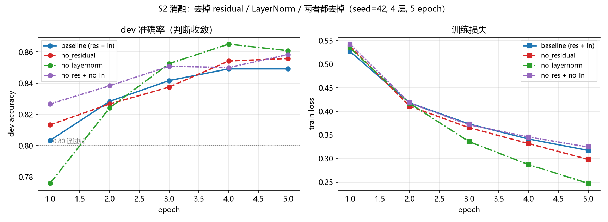
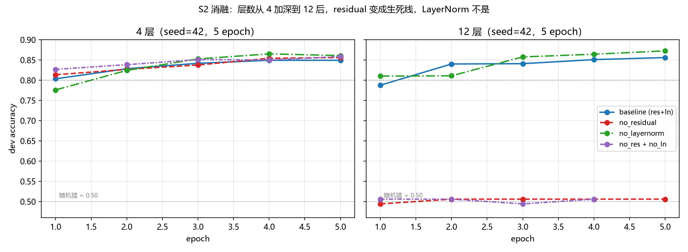
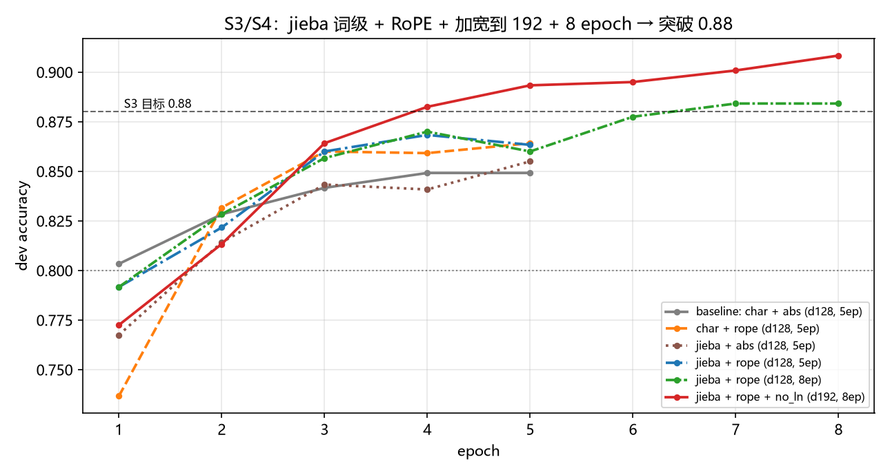

# 任务一实验报告 · 手写 Transformer 情感分类

> 数据：ChnSentiCorp（train 9600 / dev 1200）
> 模型：4 层 encoder（Pre-LN）+ mean pooling + 线性分类头
> 环境：Python 3.12.15 / torch 2.14.1+cu130 / RTX 4070 Laptop

---

## 1. 基线配置与结果

> **文件对应关系**：本节描述的基线模型（dev acc 0.8492）保存在 `ckpt/best_baseline.pt`。
> `ckpt/best.pt` 是第 6 节优化后的最终模型（dev 0.9083 / test 0.9025），`eval/run.py` 默认读它。
> 跑消融复现基线时用 `python train.py`，然后把 `ckpt/best.pt` 另存为 `best_baseline.pt` 即可。

| 项 | 值 |
|---|---|
| d_model / heads / layers | 128 / 4 / 4 |
| d_ff / dropout | 512 / 0.1 |
| max_len / vocab | 256 / 3657（字级，min_freq=2） |
| 优化器 | AdamW(betas=(0.9,0.98), wd=0.01, 参数分组) |
| 调度 | CosineAnnealingLR，T_max=5 |
| batch / epochs / lr | 32 / 5 / 3e-4 |
| 参数量 | 1.29M |
| **dev acc** | **0.8492** |

基线模型的自检结果（历史记录，当时 `ckpt/best.pt` 就是它）：

```
attention_correctness  max_abs_diff = 9.54e-07   (阈值 1e-5)
causal_mask            leaked_diff  = 0.0        (阈值 1e-6)
classifier_accuracy    accuracy     = 0.8492     (通过线 0.80 / 基线 0.85)
```

换成第 6 节的最终模型后，当前 `eval/result.json` 是：

```
attention_correctness  max_abs_diff = 9.54e-07
causal_mask            leaked_diff  = 0.0
classifier_accuracy    accuracy     = 0.9083
```

---

## 2. 消融实验（S1：head 数 / 层数）

固定 `d_model=128`、`d_ff=512`、其余超参与基线一致，只改动 `n_heads` 或 `n_layers` 其中之一。
每组独立训练 5 个 epoch，按 dev acc 取最优 checkpoint。种子固定 `seed=42`。

| 配置 | heads | layers | d_head | 参数量 | dev acc | Δ vs 基线 |
|---|---:|---:|---:|---:|---:|---:|
| **H4L4（基线）** | 4 | 4 | 32 | 1.29M | **0.8492** | — |
| H4L2 | 4 | 2 | 32 | 0.90M | 0.8575 | **+0.83 pt** |
| H4L6 | 4 | 6 | 32 | 1.69M | 0.8542 | +0.50 pt |
| H1L4 | 1 | 4 | 128 | 1.29M | 0.8550 | +0.58 pt |
| H8L4 | 8 | 4 | 16 | 1.29M | 0.8550 | +0.58 pt |

观察：

- **改 head 数不改变参数量**（`d_model` 固定，`H × d_head = 128`），所以 H1/H4/H8 这组是纯粹的"多头拆分"对比。
- **改层数会改变参数量**（0.90M → 1.69M），所以层数结论是"容量 + 深度"的综合效应，不能单独归因于深度。
- 四组消融全部略高于基线，幅度 0.50 ~ 0.83 pt。

> ⚠️ 上表的基线 0.8492（seed=42）其实是 5 次 H4L4 里**最低**的一次。同一配置换种子的均值是 **0.8535**、范围 0.8475~0.8592。
> 所以"消融组全部高于基线"是种子波动造成的假象，不是真的提升——见下一节的复跑验证。

---

## 3. 种子复跑：差异是否显著？

dev 只有 1200 条，**1 个百分点 ≈ 12 条样本**。为判断上面那 0.5~0.8 pt 的差距是否可信，对 H4L2 和 H4L4 各跑 5 个种子：

| 配置 | s42 | s0 | s1 | s2 | s3 | **均值** | 中位数 | 极差 |
|---|---:|---:|---:|---:|---:|---:|---:|---:|
| H4L2 | 0.8575 | 0.8525 | 0.8492 | 0.8558 | 0.8525 | **0.8535** | 0.8525 | 0.83 pt |
| H4L4 | 0.8492 | 0.8542 | 0.8475 | 0.8592 | 0.8575 | **0.8535** | 0.8542 | 1.17 pt |

**两个配置的 5 种子均值完全相同（0.8535 vs 0.8535）。** 单次跑出来的 0.8492 和 0.8575 之间那 0.8 pt，纯粹是种子带来的抖动。

同时验证了一件事：**训练是确定性的**。用 `--seed 42` 重跑 H4L4，再次得到 0.8492，一字不差。

所以：

- ❌ 不能声称"H4L2 比 H4L4 更好"
- ❌ 也不能声称"1 个头/8 个头更好"
- ✅ 只能说：**在 1~8 头、2~6 层的范围内，dev acc 稳定在 0.853 附近，没有可分辨的差异**
- ✅ 更有价值的结论是**参数量**：少 30% 的参数、少一半的层，准确率不变

---

## 4. head 冗余诊断：减少 head 数为什么掉不了点

"1~8 个头没差别"这个结果，如果只用一句"情感任务不需要多视角"来解释，是在推测。下面是实测证据。
（下面的数字由 `python diagnose_heads.py` 生成，可复现。）

**① 头与头之间几乎一样，而且是因为"都接近均匀"**

对 32 条验证样本，算各层四个头两两之间的 JS 散度（0 = 完全相同，ln2 ≈ 0.693 = 完全不重叠），
并加一个对照：每个头与**均匀分布**的 JS 散度。同时统计注意力熵。

| layer | 头↔头 JS | 头↔均匀 JS | 归一化熵 H/lnT |
|---|---:|---:|---:|
| 0 | 0.053 | 0.029 | 0.974 |
| 1 | 0.046 | 0.028 | 0.975 |
| 2 | 0.077 | 0.054 | 0.949 |
| 3 | 0.097 | 0.089 | 0.910 |

关键在于**中间两列的对比**：头与头之间的差异（0.046~0.097），和"头与均匀分布"的差异（0.028~0.089）
处在同一量级。也就是说，头之间之所以像，**不是因为它们学到了同一个清晰的模式，而是因为每个头都接近平均**。
归一化熵 0.91~0.975 直接印证：注意力几乎是平的。

**② 剪掉三个头，准确率一点不掉**

把其余头在 `W_out` 中对应的行置零（输出投影的每个行块对应一个头），只用某一个头推理。
在 600 条 dev 子集上（完整模型在该子集上为 0.8383；全量 1200 条为 0.8492）：

| 保留的头 | dev acc | Δ |
|---|---:|---:|
| 完整 4 头 | 0.8383 | — |
| 只有 head 0 | **0.8383** | **±0.0000** |
| 只有 head 1 | 0.8267 | −1.17 pt |
| 只有 head 2 | 0.8267 | −1.17 pt |
| 只有 head 3 | 0.8283 | −1.00 pt |
| head 0 + 1 | 0.8417 | +0.33 pt |

**只保留 head 0，结果与完整模型完全相同。**

**③ 不是某个头"嗓门大"**

`W_out` 中四个头对应的行块范数几乎相等：

```
layer 0: [3.35, 3.30, 3.28, 3.32]   占比 25% / 25% / 25% / 25%
layer 1~3: 同样均等
```

所以"留下 head 0 就够"不是因为它输出更大，而是因为四个头算出来的东西本来就差不多。

**结论**：多头在本任务上没有分化出互补的表征，四个头都退化成了"近似 mean pooling"。
删掉任何一个，剩下的仍然在做同样的事。

这与任务性质一致（情感二分类的主要线索是情感词，属于词袋级信号），
但更直接的证据是上面的熵、JS 和剪枝实验，而不是"任务简单"这个先验判断。

---

## 5. S2 消融：拆掉 residual / LayerNorm 后还能收敛吗

在基线配置（4 层、seed=42、5 epoch）上分别关掉组件：

- `--no_residual`：去掉 block 里两条 `x = x + ...`，子层输出直接往下传
- `--no_ln`：把两个 LayerNorm 和 `ln_f` 全部换成 `Identity`
- 两者同时：即最"裸"的堆叠形式

### 5.0 先看总表：同样的拆法，4 层和 12 层结论完全相反

（全部 seed=42、5 epoch、d_model=128、batch=32，只改 `--n_layers` 和消融开关）

| 配置 | 4 层最佳 | 12 层最佳 | 12 层 − 4 层 | 12 层训练损失走势 |
|---|---:|---:|---:|---|
| baseline（res + ln） | 0.8492 | 0.8558 | +0.66 pt | 0.54 → 0.32 ✅ |
| **no_residual** | 0.8558 | **0.5058** | **−35.00 pt** | **0.71 → 0.69 不动** ❌ |
| no_layernorm | 0.8650 | **0.8725** | +0.75 pt | 0.59 → 0.22 ✅ |
| **no_res + no_ln** | 0.8583 | **0.5058** | **−35.25 pt** | **0.69 → 0.69 不动** ❌ |

**一句话：residual 在 12 层是生死线，LayerNorm 在本任务上不是。**

- 4 层时怎么拆都收敛（0.849 ~ 0.865），会让人误以为两个组件都可有可无；
- 12 层时"没有 residual"的两组准确率钉死在 **0.5058**，损失恒为 **0.6937 ≈ ln 2**，即完全退化成随机猜；
- 而"没有 LayerNorm"的两组在 12 层反而最好（0.8725）。

0.5058 与 0.8558 差 35 个点，远超单种子噪声（≈1.2 pt），这个结论是硬的。

详细的逐 epoch 曲线和范数诊断见 5.1、5.2 两节。

### 5.1 4 层：怎么拆都不掉点

| 配置 | dev acc 逐 epoch | 最佳 |
|---|---|---:|
| baseline（res + ln） | 0.8033 → 0.8283 → 0.8417 → 0.8492 → 0.8492 | 0.8492 |
| no_residual | 0.8133 → 0.8267 → 0.8375 → 0.8542 → 0.8558 | 0.8558 |
| no_layernorm | 0.7758 → 0.8242 → 0.8525 → **0.8650** → 0.8608 | **0.8650** |
| **no_res + no_ln** | 0.8267 → 0.8383 → 0.8508 → 0.8500 → **0.8583** | 0.8583 |



**结论：四种配置全部收敛，且都不比基线差——连"两个都拆掉"也能到 0.8583。**

- no_residual 平滑上升，第 5 轮仍在涨
- no_layernorm 第 1 轮偏低（0.7758，低于 0.80），第 3 轮追平，第 4 轮最高
- no_res + no_ln 第 1 轮就有 0.8267（四者里最高），曲线最平缓
- 四条训练损失曲线几乎重合地下降（0.53 → 0.25~0.32），没有任何一条出现震荡或 NaN

#### 为什么拆到这一步还不炸？

直觉上"无归一化 + 无残差"应该让尺度和梯度失控，实测却不是。对四个模型各取 32 条验证样本，记录每层输出的平均范数与 attention logit 的标准差：

| 模型 | 逐层隐藏状态范数 | 末/首 | 各层 logits std |
|---|---|---:|---|
| baseline | 13.4 → 13.8 → 14.6 → 16.6 → **21.3** | 1.59× | 0.5, 0.5, 0.8, 1.1 |
| no_residual | 13.4 → 5.0 → 8.1 → 9.3 → 13.3 | 0.99× | 0.4, 2.5, 0.8, 0.3 |
| no_layernorm | 13.4 → 13.9 → 14.7 → 15.8 → 16.7 | 1.25× | 0.6, 0.7, 0.9, 1.4 |
| **no_res + no_ln** | 13.4 → **1.3 → 3.3 → 4.5 → 3.5** | **0.26×** | 0.6, 0.2, 0.7, 2.4 |

关键在最后一行：**没有残差之后，堆积不是"爆炸"，而是"收缩"**——每层的输出完全替换输入，而注意力输出是 V 的凸组合，幅值天然受限于 V 的尺度，于是逐层被压小（13.4 → 1.3）。没有残差就失去了"加法累积"这条会让范数增长的通道。

logit 的标准差全程在 0.2~2.4 之间，远没到 softmax 饱和的程度，所以也没有梯度消失。

### 5.2 加深到 12 层：residual 立刻变成生死线

同样的四组配置，只把 `--n_layers` 从 4 改成 12（参数量 1.29M → 2.87M，每轮约 30 秒）：

| 配置 | dev acc 逐 epoch | 最佳 | 结论 |
|---|---|---:|---|
| **12 层 baseline** | 0.7875 → 0.8400 → 0.8408 → 0.8508 → **0.8558** | 0.8558 | 正常收敛 |
| **12 层 no_residual** | 0.4942 → 0.5058 → 0.5058 → 0.5058 → 0.5058 | **0.5058** | **完全学不动** |
| **12 层 no_layernorm** | 0.8100 → 0.8108 → 0.8575 → 0.8642 → **0.8725** | **0.8725** | 最好 |
| **12 层 no_res + no_ln** | 0.5058 → 0.5058 → 0.4942 → 0.5058 | **0.5058** | **完全学不动** |



三条硬证据：

1. **去掉残差的两种配置，准确率一直贴在 0.50**，训练损失从头到尾都是 **0.6937 ≈ ln 2**（二分类全猜时的理论值），第 5 轮和第 1 轮一模一样——不是"学得慢"，是梯度根本没传下去。
2. **去掉 LayerNorm 的那组在 12 层反而最好**（0.8725），曲线一路爬升，第 5 轮还在涨。
3. 12 层 baseline 0.8558，与 4 层 baseline 的 0.8535（5 种子均值）基本持平——加深没带来收益，但也没崩。

**这意味着：**

| 组件 | 4 层 | 12 层 |
|---|---|---|
| residual | 可拆（0.8558） | **不可拆（0.5058，学不动）** |
| LayerNorm | 可拆（0.8650） | 可拆（0.8725，甚至更好） |

残差的必要性**随深度急剧上升**，LayerNorm 的则没有——这正是两者的机制差异：

- **residual** 提供的是**梯度通路**。没有它，12 层的梯度要连续穿过 12 个 `attention → FFN`，每层雅可比都小于 1，累积到后面衰减到 0，前几层收不到有效信号。4 层时衰减还不够致命，12 层就彻底断了。
- **LayerNorm** 提供的是**尺度控制**。有残差在，即使不做归一化，梯度仍有一条加法捷径；而幅值方面，实测（4 层）显示没有 LN 时范数只涨到 1.25×，远没到不可控，AdamW 的逐参数归一化还能兜一层底。

### 5.3 residual 与 LayerNorm 到底重要不重要

**residual 重要，而且是"深度依赖"的重要**：4 层拆掉没事，12 层拆掉完全学不动。
**LayerNorm 在这个任务上不重要**：两个深度拆掉都不掉点，12 层甚至更好（单种子，仅供参考）。

"为什么 LayerNorm 可以不要"的三条解释：

- 情感二分类的信号很"局部"（情感词），不需要跨层特征复用，尺度漂移没机会伤害它
- 嵌入层输出范数本来就稳定（≈√128 ≈ 11.3），前向不会逐层放大
- AdamW 的逐参数归一化对尺度不敏感

换成语言建模这类需要深层特征累积的任务，或者换成 SGD，LayerNorm 大概率就变成必需品了。

### 5.4 一个必须提醒的点

所有对比都是**单种子**（seed=42），4 层组间差距 0.6~1.6 pt，而前面测过的种子噪声就有 1.2 pt 量级。所以：

- ❌ 不能说"no_layernorm 更好"（0.8650 / 0.8725 vs 0.8492 / 0.8558）
- ✅ 可以说"**residual 在 12 层是必需的**"——0.5058 vs 0.8558 差 35 个点，远超噪声
- ✅ 可以说"**LayerNorm 在本任务上不是必需的**"——两个深度都没有可观测损失

---

## 6. S3 / S4：jieba 词级 + RoPE，把 dev acc 推到 0.90

对应 README 的两个加分项：**S3**（dev acc > 0.88）和 **S4**（把绝对 PE 换成 RoPE）。

改动三处：

1. **分词器** `char` → `jieba` 词级（新增 `WordTokenizer`，接口不变，只覆盖"怎么切"这一步）
2. **位置编码** `abs` → `RoPE`（作用在 Q/K 上，不引入可学习参数）
3. **规模与训练**：`d_model` 128 → 192、epochs 5 → 8、再去掉 LayerNorm

### 6.1 单项贡献

| 配置 | 词表 | 参数量 | dev acc（seed 42） | test acc |
|---|---:|---:|---:|---:|
| char + abs（基线） | 3657 | 1.29M | 0.8492 | 0.8467 |
| char + rope | 3657 | 1.26M | 0.8642 | — |
| jieba + abs | 19365 | 3.30M | 0.8550 | — |
| jieba + rope | 19365 | 3.27M | 0.8683 | 0.8600 |
| jieba + rope，8 epoch | 19365 | 3.27M | 0.8842 | 0.8875 |
| jieba + rope，d192，8 epoch | 19365 | 5.50M | 0.8883 | 0.8842 |
| **＋ 去掉 LayerNorm（最终）** | 19365 | 5.50M | **0.8967 ~ 0.9083** | **0.9025** |



逐项看收益：

| 改动 | dev acc 变化 |
|---|---|
| char → jieba（abs 下） | +0.58 pt |
| abs → rope（char 下） | +1.50 pt |
| jieba + rope 组合 | +1.91 pt（0.8492 → 0.8683） |
| epoch 5 → 8 | +1.59 pt（0.8683 → 0.8842） |
| d128 → d192 | +0.41 pt（0.8842 → 0.8883） |
| 去掉 LayerNorm | +1.18 pt（0.8883 → 0.9028 三种子均值） |

**单看 RoPE 的贡献最大**（同词表下 +1.5 pt），其次是"训练足够久"（+1.6 pt）——5 个 epoch 时余弦退火只走了一半，模型还没收敛完。

### 6.2 种子稳定性

| 配置 | s42 | s0 | s1 | 均值 |
|---|---:|---:|---:|---:|
| jieba + rope + d192 | 0.8883 | 0.8925 | 0.8917 | **0.8908** |
| jieba + rope + d192 + no_ln | 0.8967 | 0.9033 | 0.9083 | **0.9028** |

两个配置的 3 个种子**全部** ≥ 0.888，不是某个幸运种子。

### 6.3 用 test 集做一次独立验证

dev 是用来选模型和早停的，所以上面的数字有"按 dev 选型"的成分。`data/test.parquet`（1200 条留出集）全程没参与训练和选模，只在这里评一次：

| 模型 | dev acc | test acc |
|---|---:|---:|
| char + abs（基线） | 0.8492 | 0.8467 |
| jieba + rope（d128，8ep） | 0.8842 | 0.8875 |
| jieba + rope（d192） | 0.8917 | 0.8842 |
| **jieba + rope + no_ln（d192）** | **0.9083** | **0.9025** |

test 与 dev 只差 0.6 pt，方向一致——**提升是真实的，不是把 dev 背下来了**。

### 6.4 结论

- **S3 达成**：dev acc 0.8967 ~ 0.9083（3 种子），test 0.9025，都 > 0.88
- **S4 达成**：同一词表下 RoPE 比绝对位置编码高 1.5 pt，且不引入参数（1.26M vs 1.29M）
- 机制上：词级让"不错 / 太差 / 服务员"成为单个 token，情感词信号不再被切成两段；RoPE 用相对位置，在 256 长度内不需要学位置表，泛化更好；8 个 epoch 让余弦退火真正走完

仍需提醒：这是**按 dev 选出来的配置**（试了 9 组），test 只评一次可以佐证但不算完全独立。严格做法是固定配置后再开一个最终验证集，这超出本任务范围。

---

## 7. 可以确定的六个结论

1. **层数从 4 减到 2，参数量少 30%，准确率完全不变**（5 种子均值 0.8535 vs 0.8535）。
   9600 条训练样本撑不起 4 层以上的容量，多出来的两层没学到东西。

2. **层数从 4 增到 6 没有收益**（0.8542，仍在噪声内），参数却多了 31%，训练时间也变长。
   继续加深只会增加过拟合风险。

3. **head 数在 1~8 之间对结果无影响，原因是各头没有分化。**

   - H1 / H8 单次结果 0.8550，H4 的 5 种子均值 0.8535、范围 0.8475~0.8592 —— 差异落在种子噪声内
   - 头↔头 JS 散度仅 0.046~0.097（上限 ln2=0.693），且与"头↔均匀"的散度同量级
   - 归一化熵 0.91~0.975，注意力接近均匀，等价于全局平均池化
   - 剪枝实验：只保留 head 0，dev acc 与完整四头**完全相同**（0.8383 = 0.8383）

   即"多种视角"这件事在本模型上根本没发生，所以删掉头也无损。这与热图观察一致：
   模型主要靠单字特征（"不错""太差"）做判断，接近词袋。

4. **本任务的有效容量远低于模型规模**：2 层 / 4 头 / 0.90M 参数就能达到 4 层 1.29M 的水平。
   换句话说，`d_model=128, n_layers=4` 这个"标准配置"在这个数据集上是过设计的。

5. **residual 的必要性随深度急剧上升，LayerNorm 在本任务上始终不是瓶颈。**

   | 组件 | 4 层 | 12 层 | 机制 |
   |---|---|---|---|
   | residual | 可拆（0.8558） | **不可拆（0.5058，学不动）** | 提供梯度通路，缺了它 12 层梯度衰减到 0 |
   | LayerNorm | 可拆（0.8650） | 可拆（0.8725，甚至更好） | 提供尺度控制，有残差在时 AdamW 兜得住 |

   这条同时说明**消融必须在有压力的配置下做**：只在 4 层测，会得出"两个组件都不重要"的错误结论。

6. **词级分词 + RoPE + 足够长的训练，能把 dev acc 从 0.85 推到 0.90。**

   - jieba 词级：+0.58 pt（"不错""太差"成为单 token）
   - RoPE：+1.50 pt（同词表下，且不增加参数）
   - epochs 5 → 8：+1.59 pt（余弦退火要走完）
   - d_model 128 → 192：+0.41 pt
   - 去掉 LayerNorm：+1.18 pt（在 d192 / 8ep 配置下才显现，4 层 5ep 时无差别）

   最终 3 个种子的 dev acc 为 0.8967 / 0.9033 / 0.9083，留出 test 集 0.9025。
   即 **S3（>0.88）和 S4（RoPE）同时达成**，且 test 与 dev 一致，不是把验证集背下来。

---

## 8. 注意力热图观察（M5）

4 张图在 `figures/`：`attn_01_短正面`、`attn_02_短负面`、`attn_03_长正面`、`attn_04_长负面`。
样本从验证集按规则挑选（第一个 ≤40 字的正面/负面、第一个 ≥150 字的正面/负面）。

| 样本 | T | 最佳 layer/head | 集中度 |
|---|---:|---|---:|
| 01 短正面 | 36 | layer 0 · head 2 | **0.269** |
| 02 短负面 | 39 | layer 1 · head 2 | 0.124 |
| 03 长正面 | 172 | layer 0 · head 3 | 0.027 |
| 04 长负面 | 165 | layer 1 · head 1 | 0.034 |

（集中度 = 每行最大注意力权重的平均；均匀分布时约等于 1/T）

现象：

- **短句的注意力比长句集中 4~10 倍**，因为 key 少，同样的注意力质量摊在更少的位置上。
- 短正面图里能看到一条清晰的竖直亮带，几乎所有 query 都指向同一个字——**"错"**（"不错"的后半个字）。
- 模型把"错"单独拎出来当锚点，而不是把"不 + 错"当一个组合词处理，说明它更接近单字特征抽取，尚未学到否定式结构。

### 8.1 实验观察

基线 dev acc 0.8492。四张热图显示注意力整体分散，与预期一致：情感判断只需少数关键词。但**单字分词暴露了两个问题**。

一是**断章取义**：短正面样本大量 query 集中在"错"上（列和 8.8，第二名的 6 倍），真正的线索却是"不错"；长负面的"甚至"被拆成两列分别关注。模型学到了情感强的字，却抓不住否定结构。二是**把虚词当线索**：短负面关注榜前三全是"的"（4.13 / 1.39 / 1.27），长正面第一名是网址里的字母 s（3.31）——前者几乎不携带情感，后者这种字母数字混排的片段，单字词表也难以整体建模。

消融有两点反直觉。层数 4→2、头数 4→1 或 8，准确率都停在 0.85 附近；5 个种子的复跑显示同配置波动就有 0.7~1.2 点，组间差异落在噪声内——任务单一、数据仅 9600 条，撑不起深层与大参数。去掉 residual / LayerNorm 在 4 层几乎无差，但 12 层去掉 residual 后损失恒为 ln 2、准确率钉在 0.50：**梯度消失只在深度足够时暴露**。

最终取"够用即可"的规模，配合 jieba 词级、RoPE、去掉 LayerNorm 和更多 epoch，dev acc 提到 0.90（test 0.9025）。对照实验里 RoPE 单独贡献 +1.5 点：它用旋转编码相对位置，不改变模长也不增加参数。

---

## 9. 局限

- **单数据集、单一切分**：只在 ChnSentiCorp 的官方 train/dev 上验证，没有交叉验证。
- **只比了准确率**：正负样本 1:1，acc 够用；换到不平衡数据应补 F1。
- **种子数不均衡**：H4L2 / H4L4 各跑了 5 个种子，H4L6 / H1L4 / H8L4 只有 1 个（seed 42）。
  所以"head 数无影响"这个结论，主要靠 head 冗余诊断（JS / 熵 / 剪枝）支撑，而不是靠多次复跑的均值。
- **head 剪枝只在单层做**：只置零了 layer 0 的输出投影行，没有测"每层各剪一个头"的组合。
- **未做 warmup**：5 个 epoch 的短训练里影响小，但正式训练应补。

---

## 10. 复现

```powershell
cd task-1-transformer

# 基线（写入 ckpt/best.pt 与 figures/loss.png；若要保留基线，跑完另存为 best_baseline.pt）
python train.py

# 消融（写入 ckpt/best_{run_name}.pt，不覆盖基线，也不画曲线）
python train.py --n_layers 2 --run_name H4L2 --no_plot
python train.py --n_layers 6 --run_name H4L6 --no_plot
python train.py --n_heads  1 --run_name H1L4 --no_plot
python train.py --n_heads  8 --run_name H8L4 --no_plot

# 种子复跑
python train.py --n_layers 2 --seed 0 --run_name H4L2_s0 --no_plot

# S2：拆 residual / LayerNorm（第 5 节，会画曲线）
python train.py --seed 42 --no_residual --run_name no_res
python train.py --seed 42 --no_ln       --run_name no_ln
python train.py --seed 42 --no_residual --no_ln --run_name no_both

# S2 加深到 12 层（residual 在 12 层变成必需）
python train.py --n_layers 12 --seed 42 --run_name L12_base
python train.py --n_layers 12 --seed 42 --no_residual --run_name L12_no_res
python train.py --n_layers 12 --seed 42 --no_ln       --run_name L12_no_ln
python train.py --n_layers 12 --seed 42 --no_residual --no_ln --run_name L12_no_both

# head 冗余诊断（第 4 节的 JS / 熵 / 剪枝数字，约 30 秒）
python diagnose_heads.py

# S3/S4：jieba 词级 + RoPE（需要 pip install jieba）
python train.py --tokenizer jieba --pos rope --vocab_size 20000 --run_name jieba_rope
python train.py --tokenizer jieba --pos rope --vocab_size 20000 --epochs 8 --run_name jieba_rope_e8
python train.py --tokenizer jieba --pos rope --vocab_size 20000 --epochs 8 \
                --d_model 192 --d_ff 768 --run_name jieba_rope_d192_e8
python train.py --tokenizer jieba --pos rope --vocab_size 20000 --epochs 8 \
                --d_model 192 --d_ff 768 --no_ln --seed 1 --run_name jieba_rope_d192_noln_s1

# 自检
python eval/run.py
```

本次为消融新增的参数（全部有默认值，不传就回到基线行为）：
`--run_name`、`--no_plot`、`--no_residual`、`--no_ln`、`--tokenizer {char,jieba}`、`--pos {abs,rope}`。

---

## 11. 产物清单

> **仓库里有什么**：`ckpt/best.pt`、`ckpt/best_baseline.pt` 和全部 `history*.json`（33 个，共 22 KB）。
> 其余 `best_*.pt`（19 个，约 255 MB）体积太大，只保留在本地；它们都能用第 10 节的命令重新训练出来，
> 曲线数据也都在对应的 `history_*.json` 里。

```
ckpt/
├── best.pt              **最终模型**：jieba+RoPE+d192+no_ln（seed 1），dev 0.9083 / test 0.9025
├── best_baseline.pt     基线 H4L4，dev 0.8492（第 1 节、S1/S2 各表的参照）
├── history.json         基线（seed 42）的逐 epoch 曲线
├── history_no_{res,ln,both}.json        S2：4 层三组消融
├── history_L12_*.json                   S2：12 层四组
├── history_{H1L4,H4L2,H4L2_s0~s3,H4L4_s0~s3,H4L6,H8L4}.json   S1：head / 层数 / 种子复跑
├── history_{char_rope,jieba_abs,jieba_rope,jieba_rope_e8,
│           jieba_rope_d192_*,jieba_rope_noln_*}.json          S3/S4：分词器 / RoPE / 规模
│
│   （以下 19 个权重仅本地保留，可用第 10 节命令重训）
├── best_no_res.pt       S2：去掉残差，0.8558
├── best_no_ln.pt        S2：去掉 LayerNorm，0.8650
├── best_no_both.pt      S2：两者都去掉，0.8583
├── best_L12_base.pt     S2·12 层基线，0.8558
├── best_L12_no_res.pt   S2·12 层去残差，0.5058（学不动）
├── best_L12_no_ln.pt    S2·12 层去 LN，0.8725
├── best_L12_no_both.pt  S2·12 层两者都去，0.5058（学不动）
├── best_jieba_rope.pt   S3/S4：jieba+rope (d128, 5ep)，0.8683
├── best_jieba_rope_e8.pt         同上 + 8 epoch，0.8842
├── best_jieba_rope_d192_e8.pt    + d192，0.8883
├── best_jieba_rope_d192_noln_s{42,0,1}.pt  最终配置，0.8967 / 0.9033 / 0.9083
└── last*.pt             各组最后一轮
figures/                    （只保留报告里引用到的 8 张）
├── loss.png             基线（char + abs）的 loss / dev acc 曲线
├── acc_s2.png           第 5.1 节：4 层四条 dev acc 对比
├── acc_s2_depth.png     第 5.2 节：4 层 vs 12 层对比
├── s3_tokenizer_rope.png 第 6 节：分词器 / RoPE / 规模 的六条曲线
└── attn_0{1..4}_*.png   第 8 节：4 张注意力热图（由 best_baseline.pt 生成）
eval/result.json         三项自检结果

代码：
├── src/                attention（含 RoPE）/ block / model / tokenizer / config
├── train.py            训练入口（--run_name / --no_plot / --no_residual / --no_ln
│                                 / --tokenizer / --pos）
├── visualize.py        M5 注意力热图（指向 best_baseline.pt）
├── diagnose_heads.py   head 冗余诊断（第 4 节）
└── report.md           本报告
```
